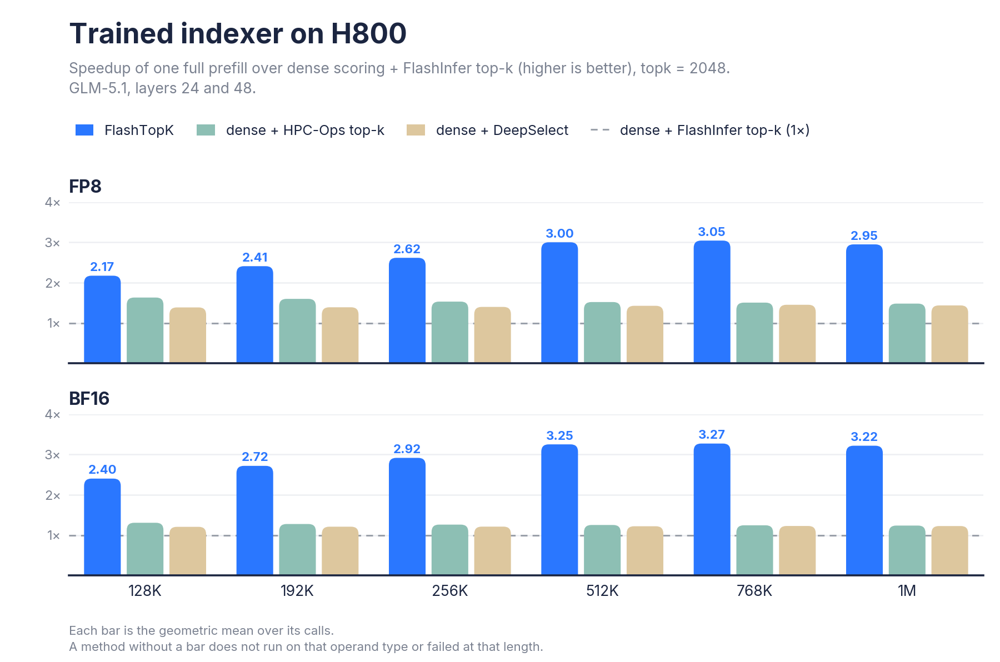
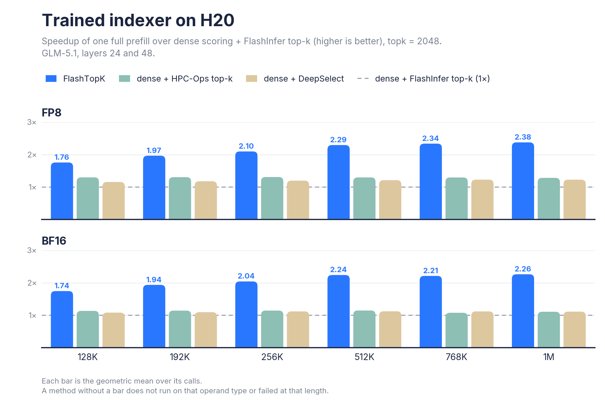
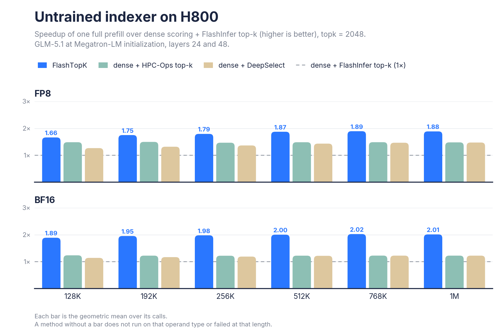
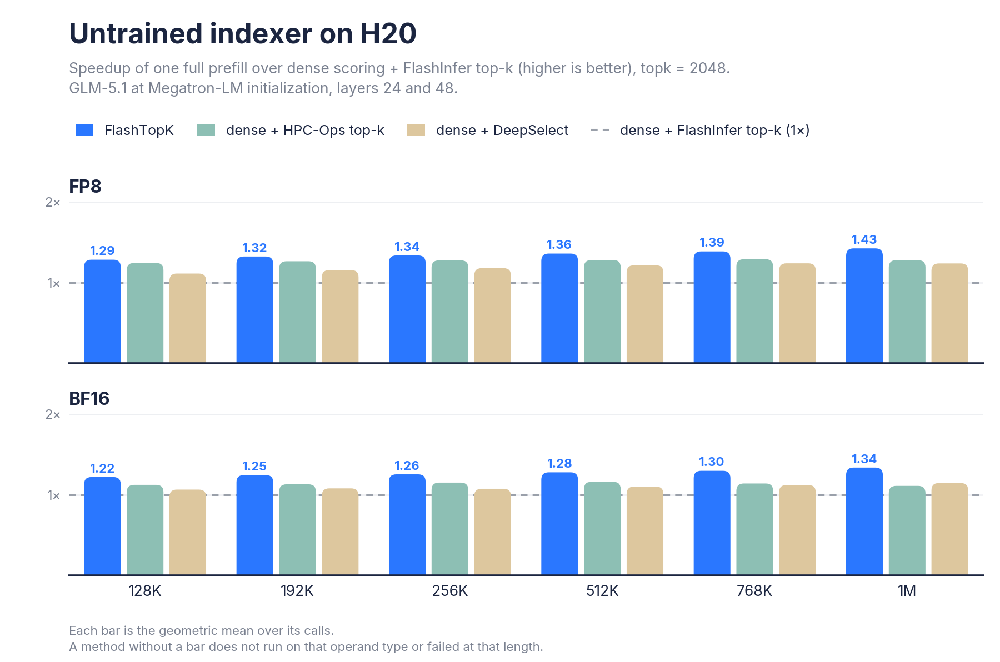
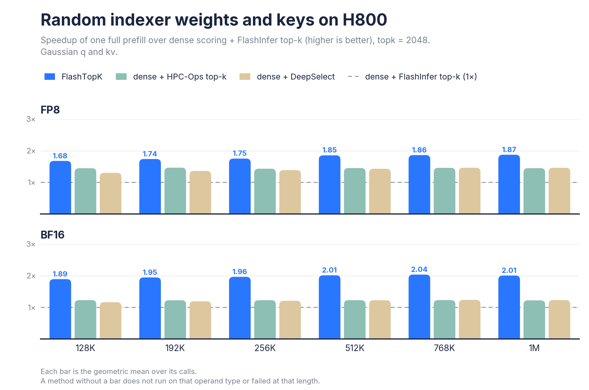
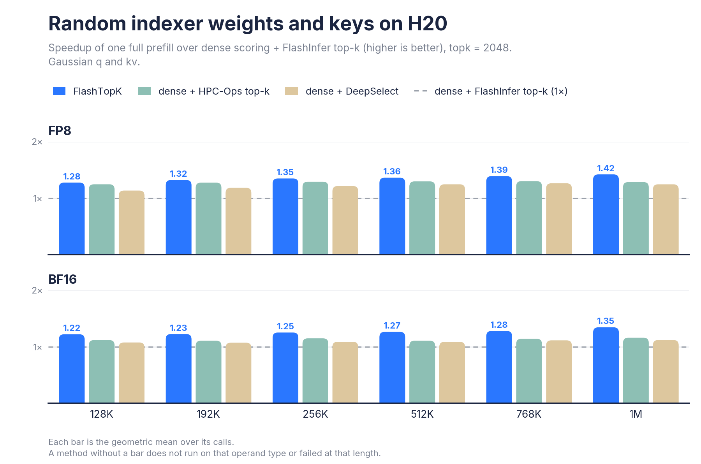

# FlashTopK performance report

FlashTopK against dense scoring + FlashInfer top-k and two public top-k selectors. See the [README](../README.md) for installation and usage.

## Setup

* **GPUs:** H800 and H20, with FP8 and BF16 operands.
* **Inputs:** a trained GLM-5.1 indexer (layers 24 and 48), an untrained one at initialization (the same layers), and random indexer weights and keys. The model sets are SGLang's indexer inputs over the first 1M tokens of the InfiniteBench document `longbook_qa_chn` #123; [`reproduce/`](../reproduce/README.md) regenerates them and reruns every number and figure here.
* **Calls:** one full causal prefill per sequence, query rows = keys = 128K, 192K, 256K, 512K, 768K or 1M; `topk = 2048`. Each method splits the prefill as it does on its own (below).
* **Timing:** every method back to back on the same GPU and calls; CUDA events, the median of 3 runs after 1 warmup. A bar is the geometric mean over the calls of one length that the method finished.
* **Exactness:** 8192 rows of every call (the last 4096 and 16 blocks of 256 spread over the rest) against the top-k of the dense FP32 scores, and the first 2047 rows, whose windows hold fewer than `topk` keys and must select all of them.
* **Software:** PyTorch 2.13, Triton 3.7.1, CuTe DSL 4.5.2.

**Baseline: dense scoring + FlashInfer top-k**, the dense prefill path of SGLang and vLLM. It builds the `[rows, keys]` FP32 score table with DeepGEMM's `fp8_fp4_mqa_logits` (FP8) or cuDNN frontend's `indexer_forward_wrapper` (BF16, the kernel behind Megatron-LM's `--dsa-kernel-backend cudnn`), then selects with FlashInfer's `top_k_ragged_transform`. HPC-Ops and DeepSelect select from the same table. BF16 weights are rounded to BF16 values for every method, as cuDNN requires.

How each method splits a full prefill:

| method | split |
|---|---|
| **FlashTopK** | `chunk_size` rows at a time; the default, 65536, is the smallest size within 2% of the fastest on every GPU measured |
| dense scoring + FlashInfer top-k, HPC-Ops, DeepSelect | row blocks whose FP32 score table fits in 35% of free memory, in whole 4096-row blocks |

## Methods

| method | version measured | GPUs, operands | deterministic | exact |
|---|---|---|---|---|
| **FlashTopK** | this repository | SM90; FP8, BF16 | bit for bit | yes |
| dense scoring + [HPC-Ops](https://github.com/Tencent/hpc-ops) `hpc.topk` | HPC-Ops `2a2e265` | SM90; FP8, BF16 | no: 72% of reruns select another set | yes |
| dense scoring + [DeepSelect](https://github.com/deepseek-ai/DeepSelect) `deep_select.topk` | DeepSelect `bfa4507` | SM90; FP8, BF16 | bit for bit | yes |
| dense scoring + FlashInfer top-k | [DeepGEMM](https://github.com/deepseek-ai/DeepGEMM) 0.2.2, [cuDNN frontend](https://github.com/NVIDIA/cudnn-frontend) 1.25.0, [FlashInfer](https://github.com/flashinfer-ai/flashinfer) 0.7.1 | SM90; FP8, BF16 | no: 80% | yes |

* **Deterministic:** the share of reruns that selected a different set (two reruns per call, on prefill chunks of 4K-32K rows).
* **Exact:** the row matches the top-k of the dense FP32 scores, up to keys within 1e-5 of the k-th score. No method returned a wrong row. FlashTopK's different FP32 summation order moves 0.05% of its checked rows within that margin; the baseline's own ties move 0.03%.

## Results

### Trained indexer





FlashTopK is the fastest at every length, GPU and operand type, and its lead grows with the length: on H800 FP8, 2.2x the baseline at 128K and 3.0x at 1M. HPC-Ops and DeepSelect keep the score table and stay at 1.1-1.6x.

### Untrained indexer





The score bound skips few keys, so FlashTopK mostly scans; it still leads at 1.2-2.0x the baseline.

### Random indexer weights and keys





No structure at all; FlashTopK still leads at every length.

### Memory

FlashTopK holds no score table. Its workspace is about 8 * min(rows, chunk_size) * max(4 * topk, 16384) bytes: 8 GiB at the default `chunk_size`, at any length. At 1M a call holds about 10 GiB beside its operands and its 8 GiB of indices: the workspace and a 0.5 GiB buffer of one slice's scores. `return_scores=True` returns every row's scores as well, 7.5 GiB more. The baseline holds a 16 GiB score table per 4096-row block at 1M keys, and 35% of free memory allows one block on H800 and H20.

### Time of one full prefill

FlashTopK / dense scoring + FlashInfer top-k on the trained indexer (the median over its two layers):

| length | H800 FP8 | H800 BF16 | H20 FP8 | H20 BF16 |
|---:|---:|---:|---:|---:|
| 128K | 68.2 / 148 ms | 101 / 241 ms | 200 / 350 ms | 371 / 645 ms |
| 192K | 134 / 322 ms | 195 / 528 ms | 399 / 782 ms | 753 / 1454 ms |
| 256K | 216 / 565 ms | 319 / 928 ms | 662 / 1384 ms | 1264 / 2574 ms |
| 512K | 738 / 2213 ms | 1119 / 3636 ms | 2394 / 5488 ms | 4.66 / 10.4 s |
| 768K | 1617 / 4925 ms | 2479 / 8115 ms | 5.33 / 12.4 s | 10.4 / 23.1 s |
| 1M | 2912 / 8580 ms | 4.46 / 14.3 s | 9.55 / 22.7 s | 18.8 / 42.5 s |

## Run the benchmark

To rerun the full comparison against FlashInfer, HPC-Ops and DeepSelect, follow [`reproduce/README.md`](../reproduce/README.md). It includes pinned dependencies, input generation and downloads, benchmark commands that generate performance records locally, and figure generation.

[`benchmarks/bench.py`](../benchmarks/bench.py) times FlashTopK on your GPU:

```sh
# Synthetic calls, random weights and keys with causal windows: synthetic:DTYPE:KEYS:ROWS[:SEED], DTYPE fp8 or bf16.
# ROWS = KEYS is a full prefill.
python benchmarks/bench.py --out run.jsonl synthetic:fp8:128K:128K synthetic:bf16:1M:1M

# Saved calls (format below). @FILE reads one job a line; "PATH ROWS" keeps the call's last ROWS rows.
python benchmarks/bench.py --out run.jsonl call.pt @calls.txt

# Options:
#   --pruning {adaptive,always,off}   key pruning mode (default adaptive)
#   --chunk-size ROWS                 the selector's chunk_size (default 65536)
#   --scores                          return the scores too (return_scores=True); the digest then covers them
#   --warmup 3 --iters 10             timed runs: the median of ITERS after WARMUP
#   --cuda-graph                      also time replays of a captured CUDA graph
#   --shard I/N                       run every N-th job, starting at the I-th
```

Each call appends a JSON line to `--out` with `median_ms`, `pruned`, `bad_rows` and a `digest` of the selection; equal digests mean the same keys with the same score bits. A rerun skips the calls already in the file.

### Saved calls

To time your own model, save its indexer calls as `torch.save` dicts:

| key | shape | dtype | content |
|---|---|---|---|
| `q_fp8` | `[rows, 32, 128]` | `float8_e4m3fn` | queries: 32 heads of dimension 128 |
| `kv_fp8` | `[keys, 128]` | `float8_e4m3fn` | keys, one per token |
| `kv_scales` | `[keys]` | `float32` | each key's dequantization scale |
| `w_eff` | `[rows, 32]` | `float32` | head weights, with every scale of the queries multiplied in |
| `starts`, `ends` | `[rows]` | `int32` | row `r` scores keys `[starts[r], ends[r])` |

A BF16 call has `q` and `kv` in `bfloat16`, `weights` in place of `w_eff`, and no `kv_scales`. Row `r` scores key `t` as `kv_scales[t] * sum_h w_eff[r, h] * relu(q_fp8[r, h] . kv_fp8[t])`, with the ReLU per head.

**FP8:** an FP8 call is the arguments of DeepGEMM's `fp8_fp4_mqa_logits`, which vLLM and SGLang call in prefill. Wrap it to save every call, with CUDA graphs off:

```python
import itertools, os, torch, deep_gemm

os.makedirs("calls", exist_ok=True)
calls = itertools.count()
mqa_logits = deep_gemm.fp8_fp4_mqa_logits

def save_and_score(q, kv, weights, ks, ke, *args, **kwargs):
    call = dict(q_fp8=q[0], kv_fp8=kv[0], kv_scales=kv[1].reshape(-1).float(), w_eff=weights.float(),
                starts=ks.int(), ends=ke.int())
    torch.save({k: v.cpu() for k, v in call.items()}, f"calls/call{next(calls)}.pt")
    return mqa_logits(q, kv, weights, ks, ke, *args, **kwargs)

deep_gemm.fp8_fp4_mqa_logits = save_and_score   # where your stack looks it up, before the model runs
```

This assumes DeepGEMM 0.2's operands: `q[1]` is `None` and each key has one float32 scale. Unpack MX scales into `kv_scales` and `w_eff` first.

**BF16:** where your indexer has its BF16 queries, keys and weights:

```python
def save_call(path, q, k, weights, starts, ends):
    """q [rows, 32, 128] and k [keys, 128] in bfloat16, weights [rows, 32]; row r scores keys [starts[r], ends[r])."""
    call = dict(q=q, kv=k, weights=weights.float(), starts=starts.int(), ends=ends.int())
    torch.save({key: v.cpu() for key, v in call.items()}, path)

# A causal prefill: the rows are the last tokens of the sequence (all of them in a full prefill).
ends = torch.arange(k.shape[0] - q.shape[0] + 1, k.shape[0] + 1, dtype=torch.int32)
save_call("calls/call0.pt", q, k, weights, torch.zeros_like(ends), ends)
```

Then time them with `python benchmarks/bench.py --out mine.jsonl calls/*.pt`.
